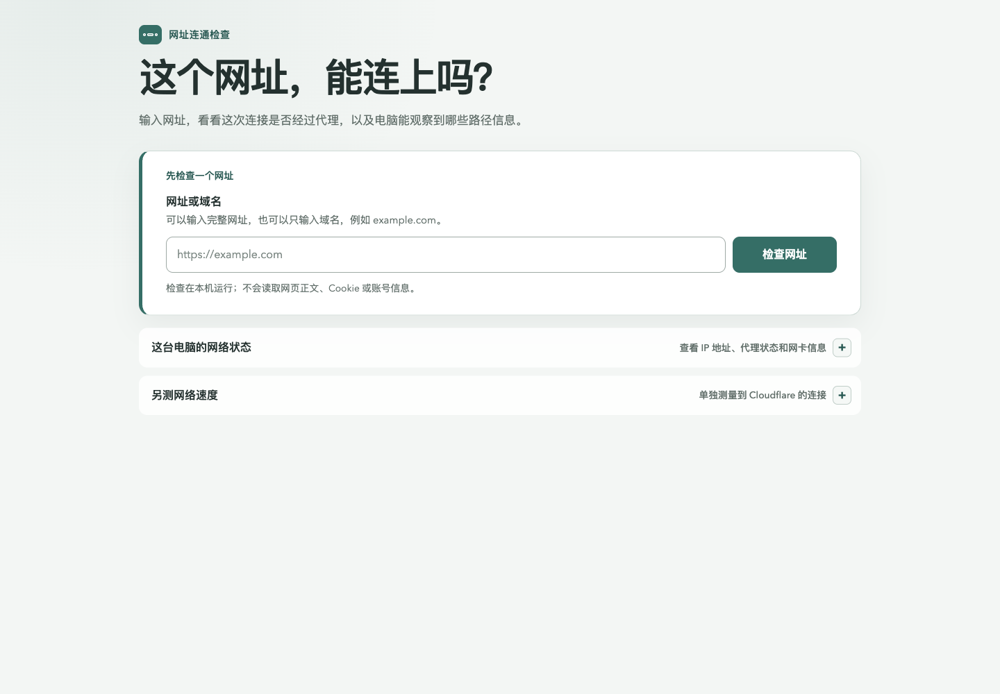

# Network Path Explorer · 网络路径助手

**想知道一个网站有没有走代理？输入网址，先看中文结论，再查看路径和证据。**

An early-stage, local-first macOS network diagnostic tool with a Chinese interface.
It explains evidence-backed DIRECT / PROXY / REJECT / UNKNOWN decisions, logical
Mihomo chains, local and egress IP addresses, optional traceroute, and speed tests.

当前版本：macOS 13+ / Apple Silicon，MIT 开源。项目尚处早期，暂无经过核实的公开使用量或月下载量。



界面预览使用本地测试夹具，不包含真实网络数据。

## 使用顺序

1. 启动本地程序，浏览器会打开界面。
2. 输入希望检查的网址，点击“检查网址”。
3. 先看中文结论；需要了解原因时展开路径与技术证据。
4. 想检查网络速度时，再主动运行测速。

网址检测反映工具发起的这一次请求；它不等同于浏览器已登录页面的完整加载过程。

这是一个在本机运行的 macOS 工具。输入 HTTP 或 HTTPS 网址后，它把“这一次请求在本机能确认的事实”分层展示出来：系统代理设置、Mihomo 决策、DNS/路由、连接结果，以及可选的路由追踪和测速。它不把某一层的结果冒充成另一层的结果。

## 先看懂几个词

- `DIRECT` 只表示 Mihomo 对这一次请求没有使用代理；它不表示“国内网络”，也不表示没有透明代理。
- 系统代理是 macOS 当前的配置；TUN 是本机是否有虚拟网卡接管流量；Mihomo 决策是规则选择的 `DIRECT`、`PROXY`、`REJECT` 或 `UNKNOWN`。三者分别回答不同问题。
- 逻辑中继链显示 Mihomo 规则、策略组和代理节点；它不是互联网路由跳数。路由追踪是单独的可选探测，显示能回答的 hop，未回答的 hop 会标为未知。
- 公网出口 IP 是一次单独的出口观察；测速是 Cloudflare 提供的另一条测速路径。它们都不能证明网址诊断请求一定经过同一条路径。

页面会给本地地址、TUN 地址和公网地址写明范围；本地/私有地址不会被当成公网出口。控制器、出口或测速不可用时，页面显示未知或降级状态，不用“看起来像直连”来填空。

## Clash Verge / Mihomo

工具会优先发现本机 Clash Verge/Mihomo 的可用本地控制器；找不到时可以在页面中手动填写 loopback 控制器地址。控制器访问只读：只读取模式、规则决策、策略组和节点状态，不修改规则、节点、模式、TUN 或系统代理，也不把控制器地址、密钥、规则内容或节点名称放进公网请求。

## 隐私与限制

- 诊断请求只读取必要的响应头和连接结果，不读取网页正文、Cookie、账号或其他应用的连接。
- 导出的 JSON 是 v2 allowlist：保留规范化 origin、过滤后的公网地址、代理类型、Mihomo 决策类型/证据等级与来源/节点种类计数、HTTP 状态与耗时、稳定错误码和结论标题/等级。路径、查询参数、片段、凭据、本地/私有地址、规则字段、控制器数据、代理/策略/节点名称、证据摘要、网络概览、出口 IP、路由追踪和测速样本都不导出。
- 快速测速上限 40 MB，完整测速上限 200 MB；两者都有时间上限，并且页面可取消。测速使用 Cloudflare 官方测速库；Cloudflare 会收到测速所需的测速流量，但不会收到正在诊断的网址、控制器密钥或本地地址。
- 路由追踪必须由用户主动开始，也可以取消。取消或关闭页面后，不应留下追踪或测速任务。
- 没有本地控制器、没有公网出口、DNS/路由不回答或服务暂时不可用时，页面会标出未知/不可用/降级，而不是猜测地理位置或代理链。
- 本版本不支持 Windows URL 诊断、应用进程归属、进程/socket 关联，也不从地理位置推断住宅、静态或数据中心线路质量。

## 开发与测试

要求 macOS 13 或更高版本、Apple Silicon（arm64）工具链、项目固定版本的 Rust、Node.js 24.15+ 和 npm；只需要普通用户权限，不安装网络扩展、不抓包、不解密 HTTPS。

先构建嵌入式前端，再启动本地 agent：

```sh
npm --prefix web ci
npm --prefix web run build
cargo run -p network-path-agent
```

常用自动化检查：

```sh
cargo fmt --all -- --check
cargo test --workspace
cargo clippy --workspace --all-targets --all-features -- -D warnings
npm --prefix web test
npm --prefix web run build
sh scripts/build-macos.test.sh
sh scripts/smoke-macos.sh
git diff --check
```

自动化测试使用本地夹具和随机 loopback 端口，不要求运行中的 Clash，也不调用公网诊断、出口或测速服务。

## 发布构建与 U 盘启动

```sh
./scripts/build-macos.sh
file dist/macos-arm64/NetworkPathExplorer
shasum -a 256 dist/macos-arm64/NetworkPathExplorer
./scripts/smoke-macos.sh
```

产物是内嵌前端的 arm64 Mach-O 可执行文件，不需要额外 Web 服务器。把整个目录复制到 U 盘即可：

```sh
cp -R dist/macos-arm64 /Volumes/<U盘名称>/
/Volumes/<U盘名称>/macos-arm64/NetworkPathExplorer
```

当前产物没有代码签名。如果 macOS 拦截启动，先核对来源和 SHA-256；不要绕过无法确认来源的安全提示。发布哈希、自动化测试计数和人工矩阵限制见 [docs/manual-test-matrix.md](docs/manual-test-matrix.md)。

## 参与与后续工作

欢迎帮助改善中文新手体验、复现实机问题和完善跨平台能力。
参见 [新手说明](docs/getting-started.md)、[贡献指南](CONTRIBUTING.md)、[安全说明](SECURITY.md) 和 [路线图](docs/roadmap.md)。
本项目源码使用 [MIT 许可证](LICENSE)，第三方依赖遵循各自许可证。
